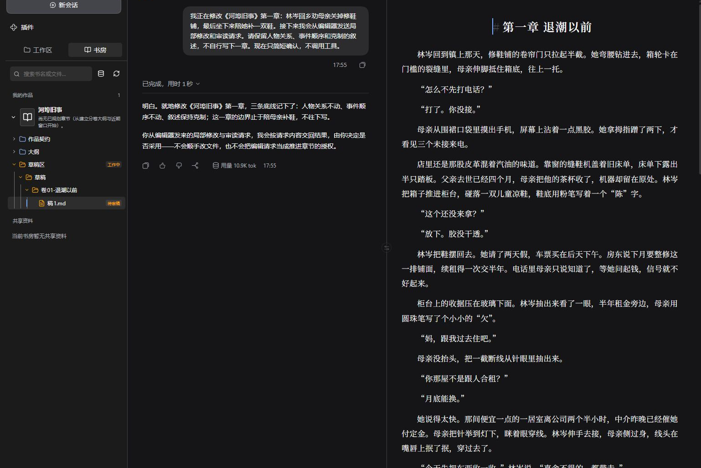
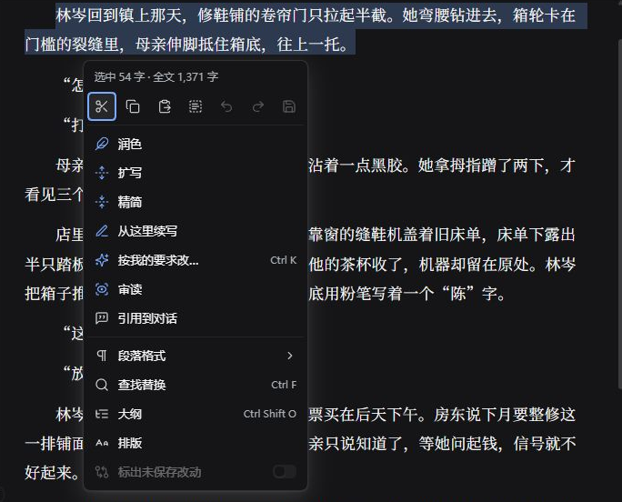
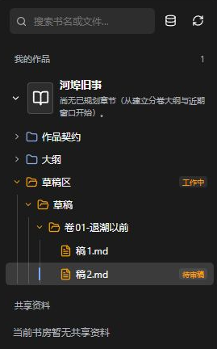
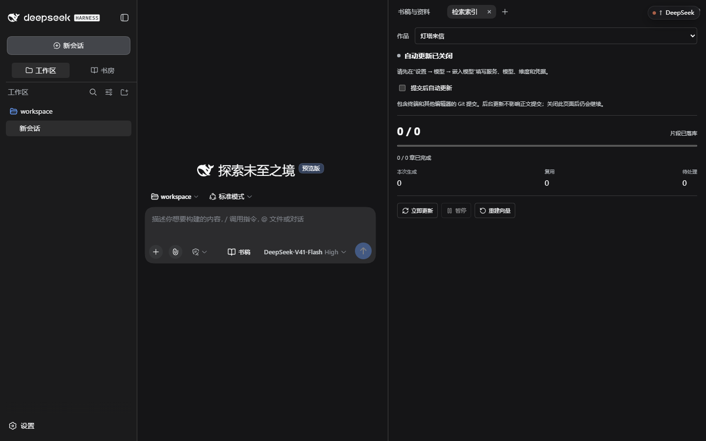
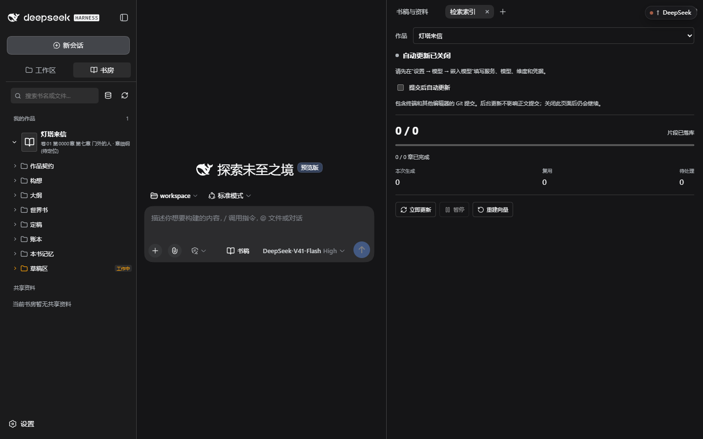
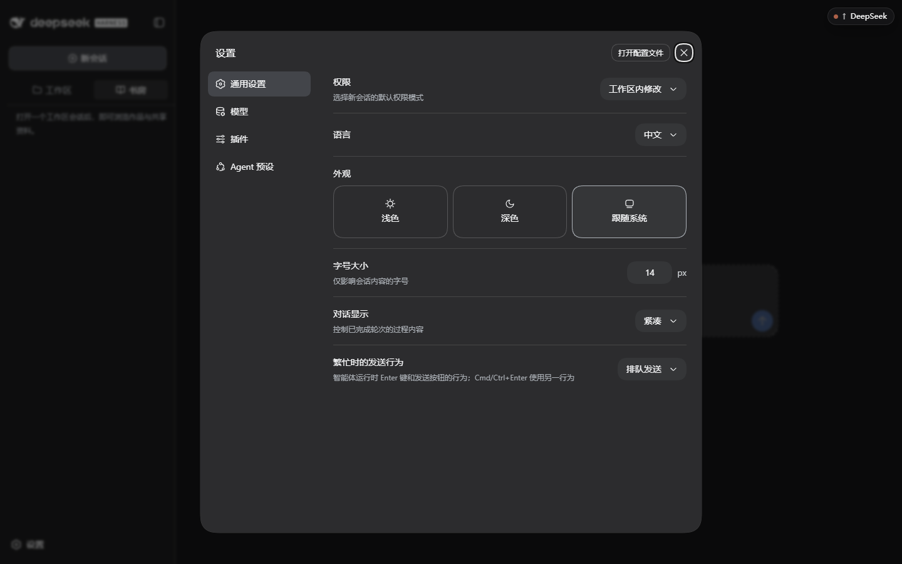
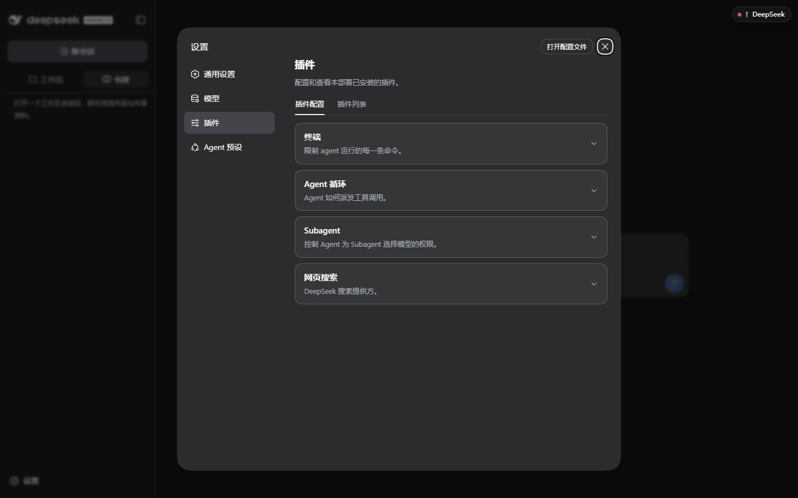
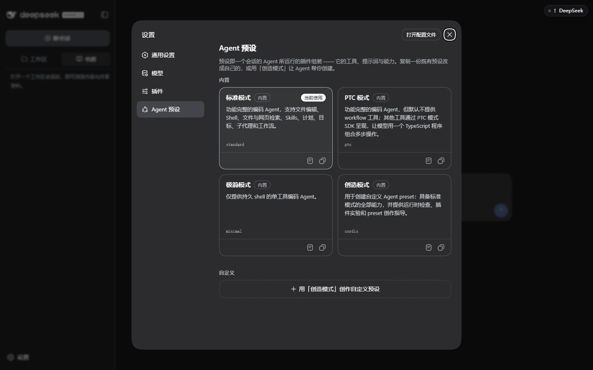

# 界面与按钮参考

这一页说明 Scriptor 8.4.0 / DSH 0.2.2-rc.1 的界面元素。工作台和编辑器截图使用原创示例《河埠旧事》，于 2026-10-06 在 8.2.0 Web 端拍摄。其他历史演示截图用于定位区域，按钮以当前界面为准。

8.4.0新增以下入口。书房顶部为 **打开插件设置**，可视化顶部为 **打开视图设置**。索引顶部为 **打开检索设置**。它们分别直达插件偏好的顶部、视图默认值和检索分组。检索 API 配置移至插件页对应组件；模型设置页保留跳转。

插件偏好只提供三个显示开关：可视化标签、布局互换按钮、索引引导卡。关闭互换按钮会还原分栏；关闭引导卡仍可从书房打开索引。书稿正文的排版继续由编辑器控制。

## 主界面分区

| 区域 | 位置 | 作用 |
| --- | --- | --- |
| 导航栏 | 最左 | 新会话、工作区／书房切换、会话搜索、设置入口 |
| 对话区 | 中间 | 与 Agent 的会话；输入框在底部 |
| 右侧面板 | 右侧（随会话打开） | 书稿与资料、检索索引等文档与状态面板 |

底部一行显示当前会话的工作目录。鼠标悬停时，可以看到完整路径。实际能访问的范围，还取决于 DSH 的访问模式。

## 左侧导航

| 元素 | 用途 | 使用时机 |
| --- | --- | --- |
| **新会话** | 开一个空白会话 | 换任务或换书时；旧会话仍在列表里 |
| **收起侧边栏** / 展开按钮 | 让出横向空间给正文 | 对照长文或看可视化时 |
| **工作区** 标签 | 列出工作区与会话 | 在多个会话间跳转 |
| **书房** 标签 | 浏览作品与共享资料 | 读稿、找文件、看作品状态 |
| **搜索会话…** | 按标题过滤会话 | 会话变多后定位 |
| **设置** | 打开设置对话框 | 配置模型、权限、外观、插件、预设 |

书稿文档标签页和「书稿与资料」面板标题上的 ● 表示有未保存的编辑内容；不要据此推断会话列表中其他状态标记的含义。

## 输入框与按钮

| 元素 | 用途 | 说明 |
| --- | --- | --- |
| **工作区选择器** | 选择／切换本会话的工作目录 | 首次使用必须显式选择，工作台不会默认接管任意目录 |
| **模式（标准模式等）** | 选择 Agent 预设 | 写小说时在新对话里选择自定义中的「写作模式」；标准模式保持原来的用法 |
| **+** | 添加附件到当前消息 | 图片、文本、日志 |
| **指令（/）** | 调出指令菜单 | 会话控制类命令 |
| **访问模式（工作区内修改）** | 当前沙箱权限档位 | 决定 Agent 能在工作区里做多少改动；调宽前先确认影响范围 |
| **书稿** | 打开右侧「书稿与资料」面板 | 需要一边看正文一边对话时 |
| **模型选择器** | 当前主模型与推理等级 | 只影响本会话；请在设置 → 模型中先把服务配好 |
| **发送** | 提交消息（忙碌时按设置排队或打断） | 见「通用设置 → 繁忙时的发送行为」 |

## 书稿与资料（右侧面板）

| 元素 | 用途 |
| --- | --- |
| 文档标签页 | 一个文档一个标签，● 表示有未保存修改 |
| 书名 / 相对路径 | 明确这段正文属于哪本书的哪个文件 |
| 稿件版本 | 查看稿N文件名及保存结果中的版本信息，核对是否打开当前稿 |
| 正文与选区浮动栏 | 可编辑文件直接修改，选区可发起改写、审读及引用 |
| 右键菜单 | 润色、扩写、精简、续写、按要求改、排版与保存 |
| 行内建议／批注 | 核对后采纳或拒绝；局部审读不等于整章审核完成 |
| 「定稿更正通过吃书补偿流程处理」 | 已定稿正文的事实性修改要走补偿流程留痕 |
| **引用到对话** | 把当前内容作为引用交给 Agent |
| **全文计数** | 当前编辑内容的字符计数，含标点和可能存在的候选事实，不同于脚本正文汉字数 |
| **保存** | Ctrl+S 或菜单保存；分别核对文件、提交与通知结果，关闭时留意未保存提示 |

旧版三模式已替换。完整操作及取消、采纳、保存说明见 [新编辑器教程](editor.md)。

可编辑文件适合直接改错别字、行文小修；**定稿正文只读，即使是错字也通过吃书补偿流程处理**。改变设定、事实或章节结构请回到对话里说清楚，让工作流留下相应记录。

## 书房

| 元素 | 用途 |
| --- | --- |
| **搜索书名或文件** | 在作品与文件树里定位条目 |
| **查看检索索引** | 打开「检索索引」面板（见 [增强索引](enhanced-index.md)） |
| **刷新书房** | 重新扫描工作区；在终端或外部编辑器改过文件后用 |
| **我的作品** | 作品卡片列表；卡片副标题给出卷章进度或需要处理的提示 |
| **文件树** | 作品契约／构想／大纲／世界书／定稿／账本／本书记忆／草稿区，逐级展开到文件 |
| **共享资料** | 工作区级别的共享文件，不属于某一本书 |
| 底部路径 | 当前工作区根目录 |

草稿区右侧的「工作中」徽标表示草稿区尚有进行中的内容，不代表已定稿。

## 工作区标签页

列出工作区与其下的会话，用于在工作区之间切换、回到旧会话。与书房可以并存：左侧看会话、右侧看稿。

## 可视化

8.4.0的「可视化」分为**关系**和**进度**两页。

- **关系**：从人物索引查找姓名、别名或路径。选中人物后查看关联方，再打开逐条证据。
- **进度**：查看当前活动和实际定稿情况。完整写作流程可展开，章节列表支持按卷、状态和章名查找。

较早关系按书仓中的标签折成星团。点击星团即可展开成员和关系。
在“阅读范围”中选择分组字段，例如势力或家族；字段名称保持原样。
默认折叠超过180章没有新证据的关系，章数可调整。
时间未知的关系另列。折叠不表示人物退场或关系失效。

画布边显示“最近记载”。关系详情按章列出标签和限定的变化。
证言、否定和推测保留标记；点击变化点可找到对应原文证据。
切章会先筛选证据，早章不会显示后来才入档的关系。
人物、关联方、星团和证据分别分页，画布只展示局部内容。

实线表示明确关系，点线表示抽取证据，箭头表示引用。
滚轮缩放，拖动移动画布或节点，“查看全图”归位。
全屏包含画布和详情，也可用“选择图谱记录”菜单操作。
点击原文会核对文件和位置；未保存的编辑会保留。

面板顶部可**选择可视化作品**、**刷新作品视图**。普通浏览只读，不改写书稿。
“管理”中可预览来源和待处理数量，再启用沉淀抽取。
首次启用后会自动增量更新并产生模型用量，可随时暂停。
抽取模型独立配置，保存模型设置不会自动启用作品。
输出长度沿用 DSH 中的模型设置，插件不另设额度上限。
API报错或超时保留已完成结果，可重试失败项。
抽取结果是辅助证据，不代表作者确认，也不回写世界书或账本。

流程节点依据工具记录显示，不会自动执行下一步。“操作完成”只表示一次调用完成，不代表整章完成；通用操作无法确定工序时显示“处理中”。失去连接后显示提示，恢复连接再核对状态。

“作者裁决”标记实际待答，答复后入档操作显示在“定稿入档”；“本章完成”的已定稿标记来自章节资料。选择某一章后，当前动作、节点和历史记录都只显示这一章。

## 检索索引（右侧面板）

列出当前书的索引进度、暂停／重试与错误信息。逐项说明见 [增强索引操作指南](enhanced-index.md)。

## 设置

| 分区 | 内容 | 说明 |
| --- | --- | --- |
| **通用设置** | 权限、语言、外观、字号大小、对话显示、繁忙时的发送行为 | 只改新会话默认值或显示偏好，不改作品文件 |
| **模型** | 主聊天提供方卡片、检索配置跳转 | 见 [最小可用配置](configuration.md) 与 [增强索引](enhanced-index.md) |
| **插件** | 插件配置／插件列表 | 查看本部署已安装的插件与其可调项 |
| **Agent 预设** | 内置标准／PTC／极简／创造模式；安装本插件后，自定义区还有「写作模式」 | 新对话选择写作模式。已开始的对话不能改预设，旧书用新的写作模式对话打开同一工作区 |

「打开配置文件」直接打开该 profile 的配置文件；手工编辑前先备份，并在改完后重新启动工作台确认加载成功。

## 状态与徽标速查

| 显示 | 含义 |
| --- | --- |
| 标签页上的 ● | 有未保存的编辑内容 |
| 文件树「工作中」 | 草稿区仍有进行中的内容 |
| 作品卡片副标题 | 当前卷的进度或需要核对的提示（例如近期窗口没有可进入条目） |
| 检索索引状态行 | 见 [增强索引](enhanced-index.md) 的状态表 |
| 输入框右侧模型名 | 本会话使用的主模型与推理等级 |
